# 🌸 Glow & Care - Bangladeshi Skincare Business Suite (ERP, eCommerce, Multi-Branch POS & Clinic)

[](https://laravel.com)
[](https://filamentphp.com)
[](https://php.net)
[](LICENSE)

An enterprise-grade, turn-key business application purpose-built for the **Bangladeshi Skincare, Cosmetics & Dermatology industry**. Designed to power all types of skincare businesses—from direct-to-consumer (D2C) social commerce brands to multi-branch retail showroom chains, BSTI genuine cosmetics importers, and medical aesthetic clinics.

---

## 🌟 Executive Overview & Business Profiles Supported

Every skincare business has unique operational needs. **Glow & Care** features a **Modular Switchboard** (`Settings > Business Modules Control`) allowing owners to run only the features they need and stop/hide what they do not:

1. **D2C Skincare Brands & Social Commerce**:
   - Ultra-high-converting single-product landing page funnels (`/landing/{slug}`).
   - Instant COD checkout without mandatory account registration.
   - Dynamic delivery charge calculation (Dhaka ৳60, Sub-Dhaka ৳100, Outside Dhaka ৳130).
   - Automated parcel dispatch via **Steadfast Courier API**.

2. **Multi-Branch Retail Chains (Dhaka, Chittagong, Sylhet, etc.)**:
   - Central Warehouse + Showroom outlets (Banani 11, Shimanto Square Dhanmondi, Sanmar Chittagong).
   - Inter-branch stock requisition and stock transfer challans.
   - Touchscreen Point of Sale (POS) with barcode scanner and daily cash drawer reconciliation.
   - 80mm thermal receipt printing in crystal-clear Bengali Unicode.

3. **Authentic Cosmetics Importers & Wholesalers**:
   - Batch number & manufacturing/expiry date tracking (auto-alert for stock expiring in 30/60/90 days).
   - BSTI certification compliance flags.
   - Wholesale dealer pricing, bulk orders, and stock requisitions.

4. **Aesthetic Clinics & Dermatologists**:
   - Patient consultations, symptom recording, and appointment calendar.
   - Dermatologist prescription notes with linked skincare product regimens.

---

## ⚡ Integrated Core Packages

| Package | Role in Application |
|---|---|
| [`imrandevbd/drutogoti`](https://packagist.org/packages/imrandevbd/drutogoti) | **Speed Optimization & Bottleneck Detection**: Query watcher, live query benchmark, N+1 detection, and 1-click route/config caching. |
| [`imrandevbd/laravel-admin-panel`](https://packagist.org/packages/imrandevbd/laravel-admin-panel) | **Admin UI & Metrics**: Modern dashboard widgets, system analytics, and headless endpoints. |
| [`imrandevbd/laravel-ai-catalog`](https://packagist.org/packages/imrandevbd/laravel-ai-catalog) | **Catalog Scraper & GEO/SEO Feeds**: Scrape specifications and descriptions from Korean/US beauty brands; generate `llms.txt` shopping agent feeds. |
| [`imrandevbd/laravel-ai-hub`](https://packagist.org/packages/imrandevbd/laravel-ai-hub) | **AI Skincare Consultant**: Multi-provider LLM (OpenAI, Gemini, Claude, DeepSeek) for skin routine diagnosis and Bengali marketing copy. |
| [`imrandevbd/laravel-attendance-hub`](https://packagist.org/packages/imrandevbd/laravel-attendance-hub) | **Showroom Biometrics**: Connects ZKTeco/ADMS biometric devices across branches to sync showroom staff attendance in real-time. |
| [`imrandevbd/laravel-unicode-pdf`](https://packagist.org/packages/imrandevbd/laravel-unicode-pdf) | **Bangla Unicode Invoices**: Native PDF engine for 58mm/80mm POS receipts, VAT Challans, and Inter-branch Challans with zero font breakage. |
| [`imrandevbd/laravel-universal-slug`](https://packagist.org/packages/imrandevbd/laravel-universal-slug) | **Multilingual SEO Slugs**: Transliterates and generates dual Bangla/English SEO-friendly URLs for skincare products and categories. |

---

## 🏛️ System Architecture

```mermaid
graph TD
    subgraph Public Frontend
        Home["/ (Home & Features)"]
        Landing["/landing/{slug} (Single Funnel)"]
        Shop["/shop (eCommerce Catalog)"]
        Quiz["/skin-quiz (AI Skin Diagnostic)"]
        Demo["/demo (1-Click Switcher)"]
    end

    subgraph Filament v3 Admin Panel
        POS["POS Terminal (Cashier)"]
        Products["Product & Batch Management"]
        Orders["Order Pipeline & Courier API"]
        Branches["Multi-Branch Stock & Challan"]
        Clinic["Clinic & Dermatologist Regimens"]
        ModulesCtrl["Module Switchboard (On/Off)"]
        DrutoUI["Speed Engine (drutogoti)"]
        AIHubUI["AI Skincare Diagnostic Hub"]
        Attendance["Showroom Biometrics (Attendance Hub)"]
    end

    subgraph External BD Services
        Steadfast["Steadfast Courier API"]
        Pathao["Pathao Courier Logistics"]
        ZKTeco["Branch Biometric Terminals"]
        BanglaPDF["Bengali Unicode PDF Engine"]
    end

    Landing -->|Quick Order| Orders
    Shop -->|Cart Order| Orders
    POS -->|Showroom Sale| Orders
    Orders -->|Auto Book Parcel| Steadfast
    Orders -->|Print Invoice / POS Receipt| BanglaPDF
    Branches -->|Transfer Challan| BanglaPDF
    Attendance -->|Sync Device Logs| ZKTeco
```



---

## 🔑 Demo Access & Personas

Test all operational roles instantly using the 1-click login switcher at [`/demo`](file:///demo):

| Persona / Role | Email | Password | Primary Capabilities |
|---|---|---|---|
| **Super Admin** | `superadmin@skincare.com` | `password123` | Full system control, branch overview, feature switches, Drutogoti optimization |
| **Branch Manager** | `banani.manager@skincare.com` | `password123` | Banani 11 outlet management, stock requisition, staff attendance |
| **Cashier / POS** | `cashier@skincare.com` | `password123` | Barcode scanning POS terminal, cash drawer, 80mm thermal receipt print |
| **Fulfillment Lead** | `delivery@skincare.com` | `password123` | Pending order review, 1-click Steadfast courier booking, live tracking |
| **Dermatologist** | `doctor@skincare.com` | `password123` | Patient clinic appointments, skin diagnosis, prescribed skincare regimens |
| **Customer** | `customer@skincare.com` | `password123` | Order history, loyalty reward points, personalized skin profile |

---

## 📦 Public Pages & Customer Experience

- **Homepage (`/`)**: Hero showcase, dynamic KPI tickers, 10 business modules overview, bestsellers, and customer reviews.
- **Features (`/features`)**: Deep-dive explanation of all modules with live examples.
- **Online Shop (`/shop`)**: Filter products by Skin Type (Oily, Dry, Combination, Sensitive), Skin Concern (Acne, Melasma, Aging, Pores), and Brand.
- **Single-Product Funnel (`/landing/{slug}`)**: Optimized for Bangladeshi TikTok and Facebook advertising campaigns. Features live shipping calculations:
  - *Inside Dhaka*: ৳60
  - *Sub-Dhaka (Savar, Gazipur, Keraniganj)*: ৳100
  - *Outside Dhaka*: ৳130
- **Skin Diagnostic Quiz (`/skin-quiz`)**: 2-minute diagnostic test that delivers morning and night regimens with recommended products.
- **Demo Hub (`/demo`)**: Direct 1-click login buttons for all 6 roles.
- **Pricing (`/pricing`)**: Transparent BDT ৳ tiers (Starter, Pro Multi-Branch, Enterprise).
- **Outlets & Contact (`/contact`)**: Showroom locations in Banani, Dhanmondi, and Chittagong with direct WhatsApp chat.
- **Documentation (`/docs`)**: In-depth API, database, and setup instructions.

---

## 🛠️ Installation & Setup Guide

### 1. Requirements
- **PHP**: 8.2 or higher (supports PHP 8.3, 8.4, and 8.5)
- **Composer**: 2.5+
- **Database**: SQLite, MySQL 8.0+, or PostgreSQL
- **Node.js**: 18+ (for asset compilation)

### 2. Clone & Install Dependencies
```bash
git clone https://github.com/imranbru99/skincare.git
cd skincare

# Install PHP dependencies
composer install

# Copy environment configuration
cp .env.example .env

# Generate application key
php artisan key:generate
```

### 3. Database Migration & Realistic Seeding
```bash
# Run all migrations (including drutogoti, universal-slug, attendance, ai-catalog)
php artisan migrate

# Seed 40+ authentic skincare products, 4 branches, orders, and demo accounts
php artisan db:seed
```

### 4. Storage Link & Asset Build
```bash
php artisan storage:link
npm install
npm run build
```

### 5. Start Development Server
```bash
php artisan serve
```
Visit **[http://127.0.0.1:8000](http://127.0.0.1:8000)** for the public storefront and **[http://127.0.0.1:8000/admin](http://127.0.0.1:8000/admin)** for the Filament Admin Panel.

---

## 🚚 Bangladeshi Courier Configuration (.env)

```env
# Steadfast Courier API Integration
STEADFAST_API_KEY=your_portal_api_key
STEADFAST_SECRET_KEY=your_portal_secret_key
STEADFAST_BASE_URL=https://portal.steadfast.com.bd/api/v1

# Unicode PDF Native Engine
UNICODE_PDF_ENGINE=native

# Universal Slugs Default Language
UNIVERSAL_SLUG_DEFAULT_LANGUAGE=bn

# Drutogoti Optimization Engine
DRUTOGOTI_ENABLED=true
DRUTOGOTI_STORAGE_DRIVER=sync
```

---

## 🔧 Useful Artisan Commands

```bash
# Run live speed and query benchmarks via Drutogoti
php artisan drutogoti:benchmark

# Simulate biometric attendance punches for demo
php artisan attendance:simulate --count=20

# Audit universal multilingual slugs
php artisan slug:audit

# Clear PDF and glyph cache
php artisan unicode-pdf:clear-cache
```

---

## 📄 License
This project is open-sourced under the [MIT License](LICENSE).
Developed with ❤️ for the Bangladeshi Skincare & Beauty Community.
