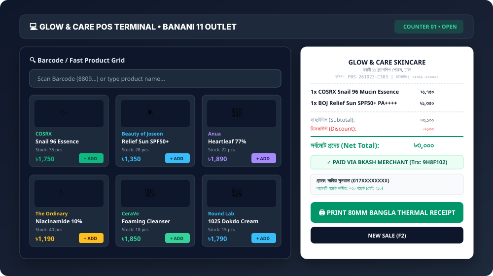
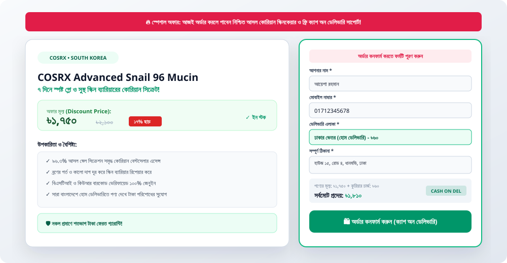
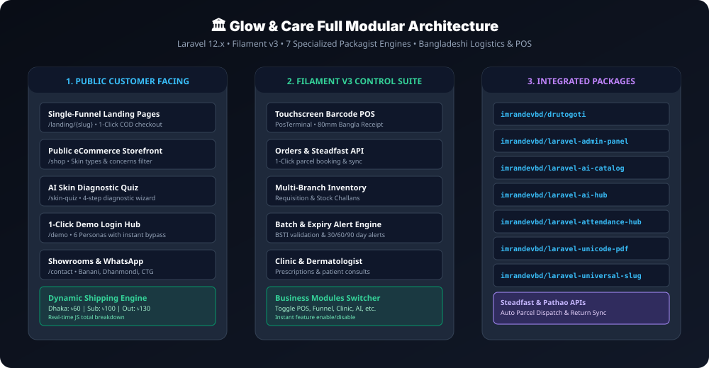
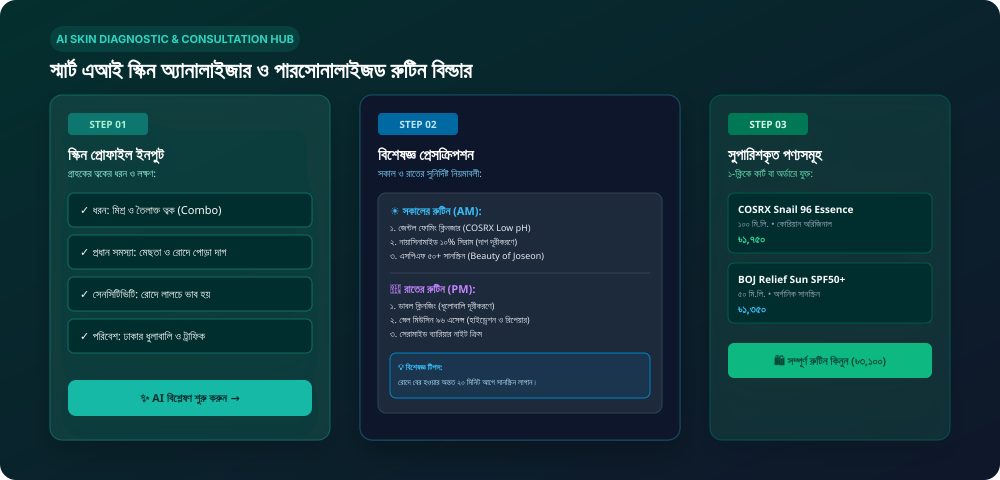

<div align="center">

# 🌸 GLOW &amp; CARE SKINCARE BUSINESS SUITE
### The Complete End-to-End ERP, eCommerce, Multi-Branch POS &amp; Clinic Platform for Bangladeshi Skincare Businesses


[](https://laravel.com)
[](https://filamentphp.com)
[](https://php.net)
[](https://steadfast.com.bd)
[](https://pathao.com)
[](LICENSE)

**[Explore Live Demo](http://127.0.0.1:8000/demo)** • **[Take Skin Quiz](http://127.0.0.1:8000/skin-quiz)** • **[View Features](http://127.0.0.1:8000/features)** • **[Pricing](http://127.0.0.1:8000/pricing)** • **[Documentation](http://127.0.0.1:8000/docs)**

---

</div>

## 📌 Table of Contents
1. [The Opportunity & Market Reality](#-the-opportunity--market-reality)
2. [ROI & Quantified Time-Saver Breakdown](#-roi--quantified-time-saver-breakdown)
3. [Visual Walkthrough & Screenshots](#-visual-walkthrough--screenshots)
4. [Integrated 7 Packagist Super-Engines](#-integrated-7-packagist-super-engines)
5. [End-to-End Business Modules](#-end-to-end-business-modules)
6. [Business Profiles Supported](#-business-profiles-supported)
7. [Live Demo Access & Personas](#-live-demo-access--personas)
8. [Public Marketing & Customer Pages](#-public-marketing--customer-pages)
9. [Step-by-Step Installation Guide](#-step-by-step-installation-guide)
10. [Courier & Payment Gateway Setup](#-courier--payment-gateway-setup)
11. [Production Deployment Checklist](#-production-deployment-checklist)

---

## 💡 The Opportunity & Market Reality

The **skincare and beauty cosmetics industry in Bangladesh is experiencing an unprecedented boom**, surpassing **\$1.2 Billion+** in annual market volume. Consumers actively seek authentic Korean (K-Beauty), Japanese (J-Beauty), North American, and European skincare formulations.

However, **90% of Bangladeshi skincare business owners suffer from severe operational friction**:

| Traditional Friction Point | The Expensive Consequence | Glow &amp; Care Solution |
|---|---|---|
| **Manual Courier Parcel Entry** | Staff spends 3–4 hours every evening typing customer addresses into Steadfast/Pathao portals; typos cause delivery failures. | **1-Click Steadfast API Parcel Dispatch**: Consignment number &amp; live tracking code generated in 0.5s. |
| **Fake Product Concerns** | Customers fear counterfeit products and abandon purchases. | **BSTI Authenticity Badges, Batch &amp; QR Tracking** directly on landing pages and invoices. |
| **Multi-Store Stock Confusion** | No sync between Central Warehouse (Tejgaon), Banani, Dhanmondi, and Chittagong showrooms. Stockouts or overstock occur daily. | **Hierarchical Multi-Branch ERP**: Real-time stock sync, digital requisitions, and inter-branch transfer challans. |
| **High Cart Abandonment on Facebook Ads** | Traditional eCommerce carts require login, email confirmation, and 5-step checkouts, losing 65%+ of mobile traffic. | **Ultra-High-Converting Single Ad Funnel** with 1-click Cash on Delivery (COD) form &amp; automatic Dhaka/Outside delivery fee math. |
| **Expired Cosmetics Losses** | Unsold Korean serums and sunscreens quietly expire on shelves, causing hundreds of thousands of Taka in inventory loss. | **Automated Expiry Alert Engine** notifying managers 30, 60, and 90 days before batch expiration. |
| **Broken Bangla Font on Invoices** | Thermal POS printers produce gibberish or broken characters on Bengali invoices. | Powered by **`imrandevbd/laravel-unicode-pdf`** for pixel-perfect Bengali Unicode 80mm thermal receipts and 5.1 tax challans. |

---

## ⏱️ ROI & Quantified Time-Saver Breakdown

How much time and money does **Glow & Care** save a growing Bangladeshi skincare brand?

```
┌──────────────────────────────────────────────────────────────────────────────┐
│                  MONTHLY OPERATIONAL SAVINGS BENCHMARK                       │
├────────────────────────────────┬──────────────────────────┬─────────────────┤
│ Operational Task               │ Before (Manual Process)  │ With Glow & Care│
├────────────────────────────────┼──────────────────────────┼─────────────────┤
│ Courier Parcel Booking         │ 90 hrs/month             │ 2 hrs/month     │
│ Counter POS Checkout           │ 3.5 min/customer         │ 35 sec/customer │
│ Daily Cash Register Balancing  │ 1.5 hrs/day              │ 5 min/day       │
│ Inter-Branch Stock Transfers   │ 40 hrs/month             │ 3 hrs/month     │
│ Product Copywriting & Bangla   │ 2 hrs/product            │ 30 sec (AI Hub) │
│ Showroom Staff Attendance Sync │ 15 hrs/month             │ 0 hrs (ZKTeco)  │
│ Expired Product Losses Saved   │ ~৳1,80,000/year          │ ৳0 loss (Alerts)│
├────────────────────────────────┴──────────────────────────┴─────────────────┤
│ 🏆 TOTAL TIME RECLAIMED: 140+ HOURS EVERY MONTH (~৳45,000+ in labor savings) │
└──────────────────────────────────────────────────────────────────────────────┘
```

---

## 📸 Visual Walkthrough & Screenshots

### 1. Showroom Point of Sale (POS) & 80mm Thermal Receipt
Designed for touchscreen monitors, tablets, and barcode scanners. Cashiers can complete sales in 3 clicks with automated bKash/Nagad/Card splits and instant **Bengali Unicode POS receipt printing**:



---

### 2. High-Converting Single-Product Ad Landing Funnel
Optimized for high ROAS on Facebook & TikTok advertising campaigns. Features real-time shipping calculation (Inside Dhaka ৳60, Sub-Dhaka ৳100, Outside Dhaka ৳130) with zero registration barriers:



---

### 3. Full Modular Architecture & Data Pipeline
A visual overview of how the customer-facing frontend, the Filament v3 management suite, and external logistics APIs interconnect:



---

### 4. AI Skin Diagnostic & Dermatologist Routine Wizard
Empowers customers to take a 2-minute clinical diagnostic test that matches their skin type (Oily, Dry, Combination, Sensitive) to targeted products with personalized Morning & Night regimens:



---

## 🚀 Integrated 7 Packagist Super-Engines

This suite is built on top of 7 specialized open-source engines published by [`imrandevbd`](https://packagist.org/packages/imrandevbd/):

### 1. `imrandevbd/drutogoti` — Speed & Bottleneck Engine
- **What it does**: Intercepts, logs, and visualizes N+1 queries, slow database queries, and cache events.
- **In-App Integration**: Head over to [`/admin/drutogoti-performance`](file:///home/imran/project/skincare/app/Filament/Pages/DrutogotiPerformance.php) for 1-click cache compilation, live database query benchmarking, and latency audits.

### 2. `imrandevbd/laravel-admin-panel` — Administrative UI & Analytics
- **What it does**: Provides clean administrative dashboard infrastructure, metrics, and headless endpoints.
- **In-App Integration**: Powers the primary KPI widgets, sales charts, and operational controls.

### 3. `imrandevbd/laravel-ai-catalog` — AI Product Scraper & Agentic Feed
- **What it does**: Automatically scrapes specifications, active ingredients, and imagery from international beauty brands; exports `llms.txt` catalogs for autonomous AI shopping agents.
- **In-App Integration**: Direct integration in catalog management and generative engine optimization (GEO).

### 4. `imrandevbd/laravel-ai-hub` — Multi-Provider LLM Intelligence
- **What it does**: High-resilience AI wrapper connecting OpenAI, Google Gemini, Anthropic Claude, and DeepSeek.
- **In-App Integration**: Powers the **AI Skincare Consultant** (`/admin/ai-skincare-hub`) and automatic Bengali product copywriter (`ProductResource` action).

### 5. `imrandevbd/laravel-attendance-hub` — Hardware Biometric Attendance
- **What it does**: Connects hardware biometric terminals (ZKTeco, ADMS, fingerprint & face recognition).
- **In-App Integration**: Automatically logs showroom floor attendance, check-ins/check-outs, and sales staff commissions across all physical branches.

### 6. `imrandevbd/laravel-unicode-pdf` — Bangla Unicode PDF & Tax Invoices
- **What it does**: Pure native PHP Unicode PDF generator with full complex script shaping (Noto Sans Bengali & SolaimanLipi).
- **In-App Integration**: Outputs 80mm thermal receipts, VAT-5.1 tax invoices, and inter-branch delivery challans with zero font breakage.

### 7. `imrandevbd/laravel-universal-slug` — Multilingual URL Slugs
- **What it does**: Automatically generates clean, collision-free, dual Bangla & English SEO slugs for products, blog posts, and landing pages.
- **In-App Integration**: Attached to [`Product`](file:///home/imran/project/skincare/app/Models/Product.php), [`Category`](file:///home/imran/project/skincare/app/Models/Category.php), and [`Brand`](file:///home/imran/project/skincare/app/Models/Brand.php) models.

---

## 🧩 End-to-End Business Modules

### ⚙️ Modular Feature Switchboard (Run or Stop Any Module)
Navigate to **Filament > System & Modules > Business Modules Control**. Every module has a live toggle switch. Disabled modules automatically hide their navigation links, routes, and API endpoints:

```
[✓] Core Catalog & Inventory      (Always Active)
[✓] Online Store & Cart           (Toggleable)
[✓] High-Converting Ad Funnel     (Toggleable)
[✓] Multi-Branch POS & Cash Reg   (Toggleable)
[✓] Steadfast / Pathao Courier    (Toggleable)
[✓] Clinic & Doctor Appointments  (Toggleable)
[✓] AI Skincare Diagnostic Hub    (Toggleable)
[✓] Biometric Staff Attendance    (Toggleable)
[✓] Wholesale & B2B Portal        (Toggleable)
[✓] Loyalty Points & SMS          (Toggleable)
```

---

### Detailed Module Capabilities

#### 1. Catalog & Skincare Attribute Management
- **Dermatological Attributes**: Skin Types (`Oily`, `Dry`, `Combination`, `Sensitive`, `Normal`), Skin Concerns (`Acne`, `Melasma / Pigmentation`, `Dark Spots`, `Pores`, `Dehydration`, `Anti-Aging`).
- **Authenticity Assurance**: BSTI certification status, Country of Origin (South Korea, USA, Canada, France, Japan), active ingredient percentages (e.g. Niacinamide 10% + Zinc 1%), and SPF/PA ratings.
- **Batch & Expiry System**: Product batch numbers, manufacturing dates, expiration dates, and low-stock threshold triggers.

#### 2. Multi-Branch & Central Warehouse
- **Hierarchical Layout**: Central Distribution Warehouse (Tejgaon, Dhaka) + Outlets (Banani 11, Dhanmondi Shimanto Square, Chittagong Sanmar).
- **Inter-Branch Stock Transfers**: Request requisition -> Central approval -> Dispatch Challan (Bangla PDF) -> Barcode verification & receiving stock balance increment.

#### 3. Touchscreen Point of Sale (POS)
- Responsive layout with hotkey shortcuts (`F2 New Sale`).
- Real-time stock lookup by barcode, SKU, brand, or Bangla name.
- Flexible payment methods: Cash, bKash Merchant / Personal, Nagad, Card Terminal, or split payment.
- Customer loyalty point calculation (1 point per ৳100 spent).
- Instant 80mm thermal receipt printing.

#### 4. Courier Logistics Automation
- **Steadfast Courier API Integration**: 1-click parcel generation, auto-fetch tracking codes, print shipping labels, and real-time delivery status polling.
- **Delivery Zone Engine**:
  - *Inside Dhaka Home Delivery*: ৳60 (24–48 hours)
  - *Sub-Dhaka (Savar, Gazipur, Keraniganj)*: ৳100 (48 hours)
  - *Outside Dhaka (All 64 districts)*: ৳130 (72 hours)
- Return & exchange handling with automatic inventory restock.

#### 5. Aesthetic Clinic & Dermatologist Regimens
- Patient consultation calendar.
- Symptom history recording and diagnosis notes.
- Dermatologist prescription builder that directly links database skincare products into structured Morning (AM) and Night (PM) regimens.

---

## 🏢 Business Profiles Supported

| Business Profile | Ideal Configuration | Primary Features Utilized |
|---|---|---|
| **D2C Facebook/TikTok Skincare Brands** | Funnels + Courier + AI | Ad Landing Funnels (`/landing/{slug}`), 1-click COD, Steadfast Courier API, AI Bangla Copywriting. |
| **Multi-Branch Retail Chains** | Multi-Branch + POS + Attendance | Central Warehouse, Showroom POS, Inter-branch Challans, ZKTeco Biometric Staff Attendance. |
| **Wholesalers & Importers** | Catalog + Expiry + Invoicing | BSTI verification, Batch & Expiry Alerts, B2B wholesale pricing, Bangla VAT-5.1 Tax Challans. |
| **Skin Clinics & Medispas** | Clinic + Consultation + Quiz | Patient appointments, Dermatologist prescription regimens, Online AI Skin Quiz. |

---

## 🔑 Live Demo Access & Personas

Test all operational roles instantly using the 1-click login switcher at [`/demo`](file:///home/imran/project/skincare/resources/views/public/demo.blade.php):

| Role / Persona | Demo Email | Password | Primary Dashboard & Capabilities |
|---|---|---|---|
| 👑 **Super Admin** | `superadmin@skincare.com` | `password123` | Master control, all branch data, module toggle switches, Drutogoti optimization |
| 🏬 **Branch Manager** | `banani.manager@skincare.com` | `password123` | Banani 11 outlet management, stock requisitions, staff attendance |
| 💻 **Cashier / POS** | `cashier@skincare.com` | `password123` | Touchscreen POS terminal, cash drawer, 80mm thermal receipt print |
| 📦 **Fulfillment Lead** | `delivery@skincare.com` | `password123` | Pending order review, 1-click Steadfast parcel booking, live tracking |
| 👩‍⚕️ **Dermatologist** | `doctor@skincare.com` | `password123` | Clinic consultations, patient symptoms, prescribed skincare routines |
| 🛍️ **VIP Customer** | `customer@skincare.com` | `password123` | Order history, loyalty reward points, personalized skin profile |

---

## 🌐 Public Marketing & Customer Pages

| Route | View File | Purpose |
|---|---|---|
| `/` | [`public/home.blade.php`](file:///home/imran/project/skincare/resources/views/public/home.blade.php) | Hero, live KPI ticker, 10-module preview, and bestsellers |
| `/features` | [`public/features.blade.php`](file:///home/imran/project/skincare/resources/views/public/features.blade.php) | In-depth breakdown of every single business module |
| `/pricing` | [`public/pricing.blade.php`](file:///home/imran/project/skincare/resources/views/public/pricing.blade.php) | BDT (৳) pricing tiers (Starter, Pro Multi-Branch, Enterprise) |
| `/skin-quiz` | [`public/skin-quiz.blade.php`](file:///home/imran/project/skincare/resources/views/public/skin-quiz.blade.php) | 2-minute diagnostic quiz generating personalized AM/PM regimens |
| `/shop` | [`public/shop.blade.php`](file:///home/imran/project/skincare/resources/views/public/shop.blade.php) | Catalog filtered by skin types, skin concerns, and brands |
| `/landing/{slug}` | [`public/landing.blade.php`](file:///home/imran/project/skincare/resources/views/public/landing.blade.php) | Single-product ad landing page with direct COD checkout |
| `/order-success/{orderNumber}` | [`public/order-success.blade.php`](file:///home/imran/project/skincare/resources/views/public/order-success.blade.php) | Order confirmation with Bangla PDF invoice download |
| `/demo` | [`public/demo.blade.php`](file:///home/imran/project/skincare/resources/views/public/demo.blade.php) | 1-Click instant login switcher for all 6 demo accounts |
| `/contact` | [`public/contact.blade.php`](file:///home/imran/project/skincare/resources/views/public/contact.blade.php) | Showroom addresses (Banani, Dhanmondi, Chittagong) & WhatsApp |
| `/docs` | [`public/docs.blade.php`](file:///home/imran/project/skincare/resources/views/public/docs.blade.php) | System architecture, API keys, and deployment guide |

---

## 🛠️ Step-by-Step Installation Guide

### 1. Prerequisites
- **PHP**: 8.2, 8.3, 8.4, or 8.5
- **Composer**: 2.5+
- **Database**: SQLite (default), MySQL 8.0+, or PostgreSQL
- **Node.js & NPM**: Node 18+

### 2. Clone Repository & Install Dependencies
```bash
git clone https://github.com/imranbru99/skincare.git
cd skincare

# Install PHP packages
composer install

# Copy environment configuration
cp .env.example .env

# Generate application encryption key
php artisan key:generate
```

### 3. Database Migration & Realistic Seeding
```bash
# Run all migrations (including drutogoti, universal-slug, attendance, ai-catalog)
php artisan migrate

# Seed 4 branches, 6 demo accounts, authentic K-beauty products, orders, and modules
php artisan db:seed
```

### 4. Storage Link & Asset Build
```bash
php artisan storage:link
npm install
npm run build
```

### 5. Start Development Server
```bash
php artisan serve
```
- **Public Storefront**: [http://127.0.0.1:8000](http://127.0.0.1:8000)
- **Filament Admin Panel**: [http://127.0.0.1:8000/admin](http://127.0.0.1:8000/admin)
- **Demo Login Switcher**: [http://127.0.0.1:8000/demo](http://127.0.0.1:8000/demo)

---

## 🚚 Courier & Payment Gateway Setup

Configure your credentials inside `.env`:

```env
# Application Name
APP_NAME="Glow & Care Skincare Suite"

# Drutogoti Optimization Engine
DRUTOGOTI_ENABLED=true
DRUTOGOTI_STORAGE_DRIVER=sync

# Steadfast Courier API Integration
STEADFAST_API_KEY=your_steadfast_api_key
STEADFAST_SECRET_KEY=your_steadfast_secret_key
STEADFAST_BASE_URL=https://portal.steadfast.com.bd/api/v1

# Pathao Logistics API (Optional)
PATHAO_CLIENT_ID=your_pathao_client_id
PATHAO_CLIENT_SECRET=your_pathao_client_secret

# Unicode PDF Native Engine
UNICODE_PDF_ENGINE=native

# Universal Slugs Default Language
UNIVERSAL_SLUG_DEFAULT_LANGUAGE=bn

# AI Hub Multi-Provider LLM
AI_HUB_DEFAULT_PROVIDER=openai
OPENAI_API_KEY=your_openai_or_gemini_key
```

---

## ⚡ Useful Artisan Commands

```bash
# Run live speed and query throughput benchmark via Drutogoti
php artisan drutogoti:benchmark

# Diagnose system latency and OPcache status
php artisan drutogoti:diagnose

# Audit universal multilingual URL slugs
php artisan slug:audit

# Simulate realistic employee biometric punches for demo
php artisan attendance:simulate --count=20

# Clear Unicode PDF font metadata cache
php artisan unicode-pdf:clear-cache
```

---

## 🚀 Production Deployment Checklist

1. **Enable Production Caching**:
   ```bash
   php artisan optimize
   php artisan view:cache
   ```
2. **Setup Background Queue Worker** (for Courier API sync & AI generation):
   ```bash
   php artisan queue:work --daemon --tries=3
   ```
3. **Setup Scheduled Cron Job** (for Expiry alerts & attendance sync):
   ```bash
   * * * * * cd /path-to-skincare && php artisan schedule:run >> /dev/null 2>&1
   ```
4. **SSL & Reverse Proxy**: Ensure Nginx/Apache proxies HTTPS requests with valid SSL certificates to secure bKash and customer checkout data.

---

## 📄 License
This project is open-sourced under the [MIT License](LICENSE).  
Built with ❤️ for the passionate skincare entrepreneurs and cosmetic brand creators of Bangladesh.
